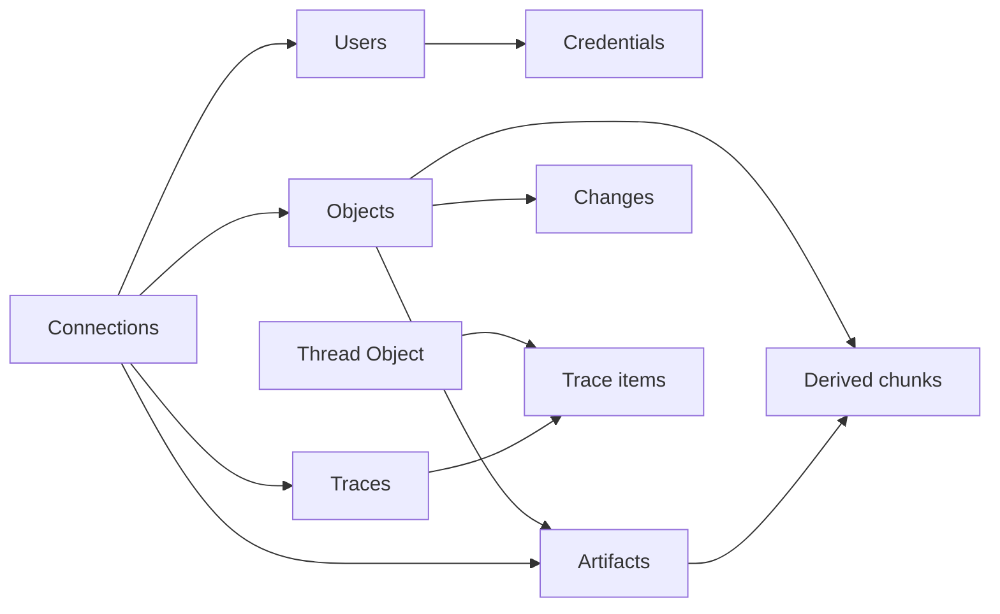

# Schema and knowledge model

This describes the **schema12 working-tree candidate**, not a deployed or fully
accepted release. The [implementation contract](atomic-schema.md) and installed
`GET /api/schema` provide exact table/field detail.

## Objects, evidence and identities

An Object represents one subject or idea. Its nine columns are `id`, `kind`,
`title`, `description`, `body`, `fields`, `revision`, `metadata`, `provenance`.
Metadata holds attribution/times; provenance records lineage and supplied history.
Neither proves truth.

| Kind | Purpose |
| --- | --- |
| `task` | Work, active User owner, due date, status and priority |
| `note` | An idea, fact, insight, question or exact excerpt |
| `entity` | A subject such as an organisation, project or person |
| `source` | A work whose original evidence is kept in Artifacts |
| `theme` | An organising concept with a unique slug |
| `event` | A supplied occurrence, distinct from a database change |
| `thread` | A captured conversation; its stream lives in trace items |

Users are dedicated identities, **not Objects**. Historical identities do not all
grant login access. Traces are observed executions, also separate from Objects.
Migration maps Memory to Note, Chat to Thread, and category memberships to Themes.

## Keep an Object atomic

The server counts this single formatted input with its pinned local tokenizer:

```text
title: {title} | text: {description}

{body}
```

The whole input, including formatting and special tokens, must fit **500 tokens**.
Title and description also retain their individual character limits. Description
states what the record is and concerns; body supports the same idea.

Oversize writes reject without saving. Commons does not silently rewrite, truncate,
split or infer new Objects. Preserve long exact material in linked Artifacts and
write a concise Object describing it. Counting tokens is local, not an inference
call; a character count is not a token count.

## Ten application tables

| Table | Owns |
| --- | --- |
| `objects` | Seven kinds and bounded current content |
| `users` | Identity/authentication; public projections exclude secrets |
| `credentials` | Hashed sessions and scoped tokens |
| `artifacts` | Exact original text/binary versions and capture metadata |
| `changes` | Mutation, historical, correction and import evidence |
| `connections` | Explained typed links with real foreign keys |
| `request_receipts` | Request hash/result and retry identity |
| `traces` | Observed execution headers and explicit historical gaps |
| `trace_items` | Paged messages, calls, results, logs and observed steps |
| `chunks` | Derived whole-Object vectors and long-Artifact passages |

Migration bookkeeping is separate from these ten application tables.



This is an ownership/link overview, not a complete cardinality diagram. An Artifact
belongs to an Object; a trace item has a Thread and may have a known Trace. Do not
invent a Trace from messages alone. Exact endpoints are in the implementation contract.

## Discovery versus deeper reads

| Content | Retrieval/use |
| --- | --- |
| Title/description | Primary keyword signals and compact result summaries |
| Body | Included in the one whole-Object semantic vector; read on deliberate open |
| Kind/owning Object | Supported explicit filters applied before ranking |
| Long eligible Artifact text | Separate evidence scope and passages; exact Unicode window reads |
| Metadata/provenance | Attribution/lineage, not arbitrary JSON embeddings |
| Changes, credentials, native span telemetry | Excluded from ordinary knowledge retrieval |

See [retrieval](retrieval.md) for eligibility, corrections, ranking and degradation.
Indexed text is not necessarily returned in full.

## Connections and safe updates

Each Connection has exactly one typed endpoint per side: Object, User, Artifact or
Trace. Use exact endpoint fields/direction and a specific explanation. Public link
kinds are `involves`, `about`, `related_to`, `depends_on`, `derived_from`, `themed`.
Internal `managed_copy` lineage is not an arbitrary user link type.

Read current endpoint revisions before linking. Tools use **`from_revision`** and
**`to_revision`**, not guessed `expected_*` aliases. Artifact endpoints have no
revision argument. Connection update/delete uses its own `expected_revision`.
Links advance affected Object revisions; read back before further edits.

Object updates partially merge `fields`; omitted body/fields remain unchanged.
Null removes an optional field, subject to whole-candidate validation. Task project
is `fields.project`, not a parsed `Project:` line. Changes preserve before/after and
correction evidence without certifying supplied claims. Original Artifacts remain
deliberately readable.

## History and adaptation

Ordinary Objects support revision-checked deletion with content removal, an ID tombstone and deletion audit. See [deletion semantics](foundation-api.md#ordinary-object-deletion). There is no Archive/Restore or protection feature. Existing migrated records marked
`provenance.historical_only=true` remain explicitly readable but are excluded from
current lists/search. This is not a new mutable lifecycle setting.

Branding is configuration; arbitrary new kinds/fields are not. Business adaptation
may require validation, migrations, indexing, tools and UI changes together. Test
in isolation, refresh [MCP discovery](connect/mcp.md), then repeat reads/writes,
retrieval and populated-upgrade checks. A complete worked adaptation is pending.

Conversation deletion has a separate [capture lifecycle](connect/capture.md),
including independent knowledge and external-backup limits. Documentation does
not migrate a live installation.
